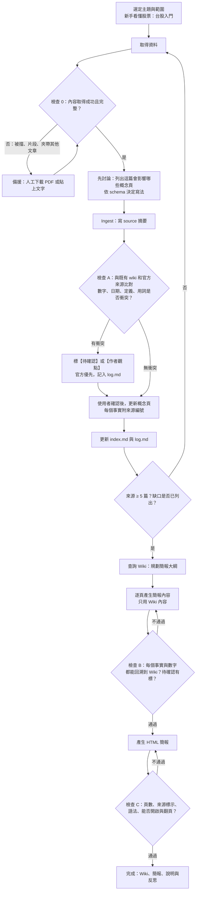

# Loop / Graph 設計與反思

## 1. 流程圖

## 2. 流程說明

| 步驟 | 做什麼 | 會重複嗎 |
|---|---|---|
| 取得資料 | 找網頁、下載 PDF 或貼文字 | 每篇來源都做一次；檢查 0 不過就走備援，再檢查 |
| 先討論 | 先列出會影響的概念頁與衝突，**不直接改 wiki** | 每篇一次 |
| Ingest | 寫 source 摘要，再更新概念頁 | 每篇一次，共 5 次 |
| 檢查 A | 和既有內容、官方來源比對 | 每篇一次；有衝突就標註 |
| 檢查 B | 簡報每個事實、數字回溯 wiki | 不通過就回到逐頁產生 |
| 檢查 C | 結構與語法檢查、實際開啟 | 不通過就回到產生 HTML |

**會重複執行的地方：**「取得資料 → ingest」跑 5 輪；每個檢查點不通過都退回前一個生成步驟；來源數量不足或缺口太大，就回到取得資料。

**為什麼這樣設計：**股票資料有大量數字與制度規則，而且網路文章常常過時或只是作者主張。越晚發現錯誤，要改的地方越多（wiki 與簡報兩處），所以把檢查放在資料進入 wiki 的時候，簡報階段只做回溯檢查。

## 3. 一次實際執行的結果與檢查紀錄

| 輪次 | 節點 | 發現的問題 | 處理方式 |
|---|---|---|---|
| s02 第 1 次 | 取得資料（檢查 0） | 證交所網頁直接讀取被網站擋下，只從搜尋結果拿到片段，表格欄位缺漏 | 改為自行把網頁存成 PDF（26 頁）再 ingest，覆蓋 s02 摘要 |
| s02 第 2 次 | 檢查 A | s01 寫「盤中零股第一次撮合後每 1 分鐘撮合」，官方 s02 為「每 5 秒」，且沿革顯示曾縮短撮合間隔 | 以官方為準，s01 標為過時，記入 log.md |
| s02 第 2 次 | 檢查 A | s01 對市價單的說明太簡化：零股只能限價 ROD、市價單只限逐筆時段 | 在概念頁補上條件 |
| s03 | 取得資料（檢查 0） | 抓取網頁時，同專題的其他文章被一起帶進來 | 只摘要指定的 ETF 文章；另一篇經使用者確認後獨立成 s04 |
| s04 | 檢查 A | 市值的股數，s04 用「發行股數」、s01 用「流通在外股數」；EPS 分母有兩種寫法；均線「將持續上漲」與 s01「不能準確預測」語氣衝突 | 兩種定義並列標【待確認】；均線採 s01 的謹慎說法 |
| s01、s03 | 檢查 A | 手續費與證交稅只有非官方來源 | 兩份來源一致，但仍標【待確認】，列入尚待補強 |
| 簡報 | 檢查 B | 用程式抽出簡報 10 頁中的所有數字（含時間），逐一比對 wiki 文字：**0 個在 wiki 找不到**；10 頁都有來源標示 | 通過。限制：只比對數字有沒有出現，不能證明語意正確，語意由人工逐頁對照 |
| 簡報 | 檢查 C | HTML 標籤配對正確、10 頁、JavaScript 語法檢查通過；**尚未在瀏覽器實際開啟** | 繳交前需自己用瀏覽器開啟，檢查翻頁與手機版，並截圖留存 |

## 4. 反思（草稿，請依自己的體驗改成自己的話）

**哪一個節點最常出錯？**
「取得資料」。5 篇來源中有 2 次在這一步就出問題：s02 被網站擋下、s03 的網頁夾帶了其他文章。這個節點錯了，後面的 ingest 與檢查都會建立在不完整的內容上。另外，內容層面的錯誤（零股撮合頻率過時、市值定義不一致）主要來自非官方來源，由檢查 A 抓出。

**把檢查前移到哪一個步驟？**
最初的想法是在簡報做完後才檢查數字與內容（檢查 B、C）。實際做了 s02 之後發現，過時的數字如果等到簡報階段才發現，要同時回頭改 wiki 和簡報。所以把檢查前移到兩個地方：
1. 取得資料後，先做「內容是否完整」的檢查（檢查 0）。
2. 每篇 ingest 時，先和既有 wiki 與官方來源比對（檢查 A），產生衝突清單並讓使用者確認後，才更新概念頁。

**有沒有修改 workflow / graph？為什麼？**
有，共四處：
1. 新增「取得失敗的備援分支」（人工下載 PDF 或貼上文字），因為網站會擋、工具也可能只抓到片段。
2. 在 schema 加上「官方來源優先」與三種標註（作者觀點、待確認、待補），讓衝突有固定的處理方式，也避免憑記憶補寫。
3. 把「先列出影響頁面與衝突、確認後才更新」寫成固定步驟，做到「先討論、後生成」。
4. 把簡報階段的檢查改成「回溯檢查」（每個數字必須出現在 wiki），而不是在簡報階段才開始找錯。

## 5. 繳交內容對照

| 繳交項目 | 對應檔案或位置 |
|---|---|
| 1. LLM Wiki 主題與簡短介紹 | README.md |
| 2. LLM Wiki 連結或成果 | GitHub repo（index.md、concepts/、sources/） |
| 3. 教學 HTML 簡報連結 | slides.html（用 GitHub Pages 發布後的網址） |
| 4. loop / graph 流程圖或文字說明 | 本檔 第 1、2 節 |
| 5. 一次實際執行的結果或檢查紀錄 | 本檔 第 3 節與 log.md |
| 6. 反思 | 本檔 第 4 節 |
